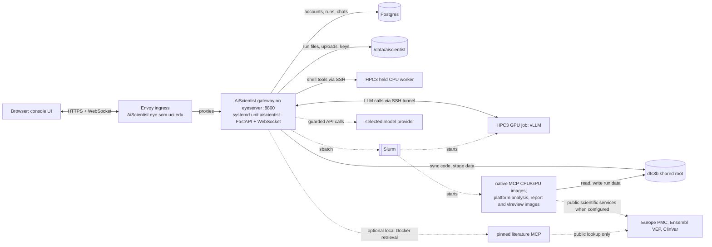
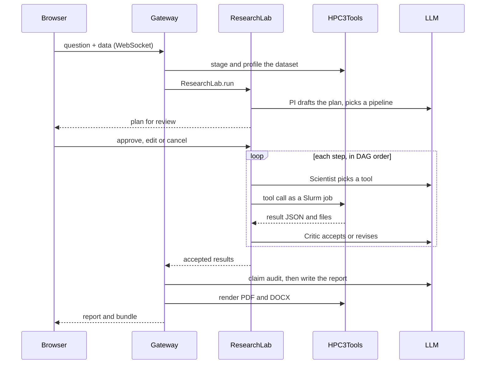
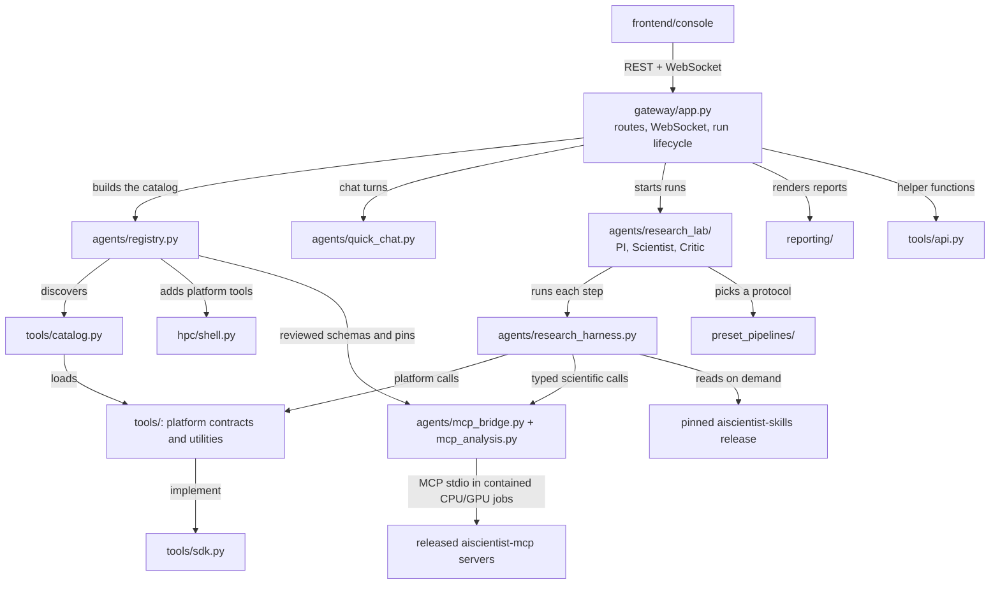
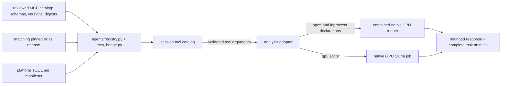

# AiScientist architecture

For whoever picks the project up: where it runs, how one research run flows, how the code is
layered, and how the tools are found and routed. What has been measured and decided along the way
is in [`../FINDINGS.md`](../FINDINGS.md).

The same diagrams, editable, are on the FigJam board
[AiScientist architecture](https://www.figma.com/board/OHeckC4jS6Yw5ET9UjBeQB) (AiScientist team).
Scientific tools are released in [aiscientist-mcp](https://github.com/lijinbio/aiscientist-mcp).
The app reviews their schemas and immutable image pins in its
[MCP catalog](../../src/aiscientist/agents/mcp_catalog/mcp_servers.json);
[platform tools](../../src/aiscientist/tools/README.md) remain in the application.

## The system in one paragraph

AiScientist is a web research agent for biomedical data (single-cell RNA-seq, VCFs, clinical
phenotypes). A user uploads data and asks a question. LLM roles form a virtual lab: the PI drafts a
plan, the user reviews it, the Scientist runs curated tools or its own code step by step (as Slurm
jobs on UCI HPC3), the Critic reviews every step, and the run ends in a cited manuscript-style report
(PDF / DOCX). A session runs on one LLM for all of its calls: Qwen3.8 in a GPU job of its own, the lab's shared model
on HPC3 GPUs (DeepSeek-V4-Flash; the default where the server keeps one), both self-hosted with vLLM, or the user's own API key.

The code namespace is `aiscientist` (package, `AISCIENTIST_*` env vars). A `bioagent` import alias and
the legacy `BIOAGENT_*` env names still work, and a few runtime identifiers outside the repository keep
the old name (Slurm job names, `~/.bioagent` on HPC3, the Postgres role and database).

## Where it runs

The gateway orchestrates and never does the heavy compute. Platform workers use the synced
application source in `pysrc/<user>`. Scientific MCP tools run the implementation packaged in
the reviewed digest-pinned server image, without an application scientific-source overlay.
Scientific changes require a new server release and a reviewed catalog update. Command and
scheduler traffic uses the user session; bulk files use the configured transfer node. A deploy is a release tag on RCHENLAB/AiScientist, which the server's deploy timer installs
([deploy/README.md](../../deploy/README.md)).

Users' data is kept on the gateway host ([dataset storage](../dataset_storage.md)); HPC3 holds a copy
only while a session's runs need it. Datasets the lab maintains for every account, such as the eye atlas, are
[shared datasets](../shared_datasets.md): published in immutable versions, with one read-only copy
on each host. A session's data movement and housekeeping there go through a
compute backend (`gateway/compute.py`: stage-in, submit, status, stage-out, clean-up), of which HPC3
is the one implementation, and the console shows each session's state as it goes (staging in,
running, staging out, cleaning up, closed, failed; `gateway/session_state.py`).

Each chat has its own dialog and its own run: attachments, draft, plan review, Stop and mid-run notes
belong to one chat. One session runs several chats at once, one run per chat, up to
`AISCIENTIST_MAX_RUNS_PER_SESSION` (default 3); they share the session's served model, which batches
their requests, and each run writes its job files in its own scratch folder. An account has one
session: a second browser or tab joins the open one instead of logging in to HPC3 again.

## One research run

Before the run, the session's model routes the request (`agents/request_router.py`): anything that
needs data or computation goes to the lab as above; a general question that published papers answer
gets a one-step literature plan instead (`agents/literature_answer.py`). Once approved, that step
calls native literature MCP for PubMed/Europe PMC and, when available, the lab's RetiGene corpus (`search_corpus`: the question's meaning and the model's exact words,
merged by rank) concurrently. The registered server runs on HPC3; separately enabled local Docker
routes preserve public lookup and offline corpus retrieval without an HPC connection. Public lookup
and corpus retrieval have distinct network policies; the model answers from the corpus passages and the abstracts, and
code writes the reference list from the papers the answer cites; the answer is kept with the run.
A question that names the RetiGene papers searches the corpus alone, and PubMed only when it asks for
it. A question about them that asks for every gene with a property ("What are haploinsufficient
genes in RetiGene papers?", "Which genes do they report as dominant negative?"; the session's model
decides, `request_router.corpus_ask`), or a haploinsufficient-gene list question that names no source
("What are haploinsufficient genes?", in a chat with no data and no analysis: its plan card says it
reads the RetiGene papers and that "search PubMed" asks the public literature), gets a RetiGene
curation plan instead. For a property other than haploinsufficiency the session's model writes a task
spec, which the plan lists and a note revises.
The plan describes the curation and its pilot/cost limits. Native `extract_haploinsufficient_genes`
uses the selected session model through its guarded binding; it does not provision a separate GPU
or substitute another model. A verified cached scan of the same corpus/spec/model can be reused.
The native server writes the scientific gene, sentence and request CSVs; the gateway stages those
files, records curation/publication metadata and answers from them. The user can save the tables
to their Datasets. A bounded or stopped scan is not described as an exhaustive whole-corpus screen. A note on any plan is routed again, so "analyse my data instead"
turns a literature plan into an analysis, and a note that makes it a list question about the RetiGene
papers turns it into the curation, once per message. The literature plan's sources are read from the
question once; after that only a note that asks for a source changes them. A request for more than
the usual 12 sources widens the search to 30 corpus passages (3 per paper at most) and 24 PubMed
papers, and the plan card and the saved method state the budget. Runs that produce processed
datasets or CellQC result folders publish those verified outputs through the existing Datasets
flow; literature-only and report-only runs do not imply such outputs. Plain fast chat (`agents/quick_chat.py`) streams a conversational answer without requiring HPC.
A permitted literature request uses the dedicated reviewed native route rather than an old local
scientific tool; no-search and private-data constraints remain in force. Explicit legacy client
route selectors use the same retained platform entry points, not retired scientific implementations. Anti-fabrication layers: the Critic's
deterministic floors (`agents/step_numbers.py`), the claim audit before writing
(`agents/claim_audit.py`), closed-set grounding facts, and `verify_report_facts` after writing. The final
manuscript loses any sentence that attributes a gene to a lineage the curated marker reference contradicts
(`agents/marker_claims.py`, run just before rendering).

## How the code is layered

| Package | What it owns |
|---|---|
| `src/aiscientist/gateway/` | The FastAPI app (`app.py`), accounts and the database, users' datasets (`dataset_storage.py`), the HPC3 session (SSH, the held worker, the GPU serve job; its compute backend and state, `compute.py`, `session_state.py`), LLM clients and bring-your-own keys, LLM usage and estimated cost (`llm_usage.py`, prices in `configs/llm_pricing.yaml`), the Slurm job executors (one per image), the environment manifest |
| `src/aiscientist/agents/` | The orchestrator: the research lab, a step's tool loop, the catalog assembly, the DAG planner, the fast chat path, skills loading and induction, claim audit and step checks, agent memory |
| `src/aiscientist/reporting/` | Turning a finished run into deliverables: pandoc render, result bundle, reference list, the vision-model render review |
| `src/aiscientist/metadata/` | Croissant 1.1 metadata of datasets and results: built from what was measured plus the owner's review, validated (mlcroissant when installed), never hand-written. The gateway keeps it in the account database and serves it through the API and the MCP server at `/mcp` ([guideline](../development/metadata.md)) |
| `src/aiscientist/hpc/shell.py` | The HPC3 shell session and its eight model tools (platform tools, like `run_code`) |
| `src/aiscientist/tools/` | Platform contracts (`sdk.py`), discovery (`catalog.py`), public utilities (`api.py`) and bounded worker operations; scientific algorithms and server entry points belong to aiscientist-mcp; scientific references are packaged or operator-mounted there, while platform configuration remains in the app |
| `preset_pipelines/` | Plain files: end-to-end protocols the PI picks. Skills are installed outside git from the repository/release in `configs/skills_registry.json` (currently `lijinbio/aiscientist-skills` v0.2.6); native instruction-only skills and adaptable CodeAct templates have separate roles |
| `frontend/console/` | The web UI |

Two files are large enough to deserve a warning: `gateway/app.py` and
`agents/research_lab/__init__.py`. Read the comments around a branch before changing it; many branches
that look redundant fix a specific production incident, and the comment says which.

`agents/research_lab/` is a package. `__init__.py` holds the `ResearchLab` class, the run itself. What
the class works with sits in the modules beside it: `prompts.py` (the role prompts), `models.py`
(`LabConfig`, rounds, results, resume state), `plan_parse.py` (reading plan text and replies),
`tooling.py` (the code tools, tool names, plan checks), `step_kinds.py` (what kind of step a plan line
is), `grounding.py` (the facts a report may state) and `literature.py` (literature steps). Every name
is importable from `aiscientist.agents.research_lab`. A test that replaces a function of one of these
modules patches it on that module.

## Tools, skills and pipelines

| | Tool | Skill | Pipeline |
|---|---|---|---|
| What it is | Fixed code called by name with JSON arguments | Guidance for registered tools, optionally an adaptable code template | An end-to-end protocol with pinned settings |
| Used by | The Scientist | The Scientist; CodeAct templates alone are adapted via `run_code` | The PI, when planning |
| How it loads | Reviewed MCP schema/image catalog; platform manifests through `tools/catalog.py` | Progressive disclosure: manifest, then SKILL.md, then optional reference.py | Matched by topic; SKILL.md + PROTOCOL.md enter the plan |
| How to add one | A tested native server release and reviewed app catalog update | A folder in the aiscientist-skills registry, then a new pinned release | A `preset_pipelines/<name>/` folder |

## How a tool is discovered and routed

Server descriptions and schemas come from a reviewed MCP `tools/list` export. The
catalog pairs them with a package version and immutable image digest; runtime
execution also verifies the installed skill binding. The model supplies scientific
arguments, while the operator controls mounts, resources and executor settings.
Native `inprocess` declarations execute in the server environment, not by importing
scientific packages into the gateway. The System page displays configured schemas;
execution still requires the connected session and its registered capabilities.

The remaining platform manifest index is generated with `python scripts/tool_docs.py`.
See [MCP bridge](../development/mcp_bridge.md) for the response, task ownership,
selected-session model relay and artifact publication contracts.

## Boundaries, enforced by tests

| Rule | Test |
|---|---|
| Tools import nothing from the platform; `sdk.py` is standard library only | `tests/test_tools_boundary.py` |
| The platform reaches the tools only through `sdk`, `catalog`, `api`, and only public names | `tests/test_repo_boundaries.py` |
| Native tools match reviewed schemas; retained platform manifests and generated docs are current | `tests/test_tool_manifests.py` |
| The catalog is the manifests plus the platform tools; routing follows `runs_on` | `tests/test_registry_manifests.py` |
| Tool names the platform keys logic on, and the ones pipelines name, all exist | `tests/test_tool_contract.py` |
| The installed pinned release loads, and its skills name only tools that exist | `tests/test_pinned_release.py` (where the release is installed) |
| Pipelines are well-formed | `tests/test_pipeline_library.py` |
| Every generated `croissant.json` is valid Croissant 1.1 (mlcroissant), and holds no server path, sample id or credential | `tests/test_croissant_metadata.py` |
| Metadata and MCP answer one account only, as `/api/datasets` does | `tests/test_metadata_gateway.py` |

## Where to start reading

1. `README.md`: product and capabilities.
2. `gateway/app.py`: `_dispatch_lab` and `_run_lab`, how one message becomes a run.
3. `agents/research_lab/`: `ResearchLab.run`, the PI / Scientist / Critic loop.
4. `agents/research_harness.py`: `ResearchHarness`, one step's tool loop.
5. `agents/registry.py` and `tools/catalog.py`: how the catalog is assembled and routed.
6. `agents/mcp_analysis.py` and the native server package: scientific dispatch, evidence and implementation.
7. `docs/skills_and_pipelines_architecture.md`, `preset_pipelines/README.md`.
8. `deploy/README.md`, `deploy/deploy_release.sh`: deploys.
9. `docs/FINDINGS.md`: what has been measured and decided, and why.
