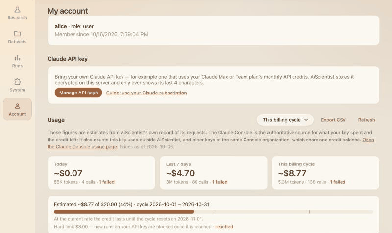
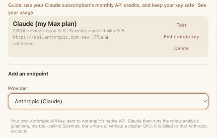

# Use your Claude subscription with AiScientist

AiScientist can run on your own Claude API key. Claude Max and Team plans include monthly API
credits, and a key from the Claude Console organization linked to your plan spends those credits
first — so you can run AiScientist on the subscription you already have. This guide covers getting
that key, adding it, keeping it safe, and watching what AiScientist spends.

Your HPC3 account still runs the analysis jobs. The API key decides which model plans, reasons and
writes, and on whose bill.

## 1. Check that your plan includes API credits

| Plan | Monthly API credits |
|---|---|
| Max 5x | $100 |
| Max 20x | $200 |
| Team, Standard seat | $20 per seat |
| Team, Premium seat | $100 per seat |
| Discounted Team plans (Nonprofit, Scientists) | $20 per Standard seat, $100 per Premium seat |

- Free, Pro and Enterprise plans have no API credits.
- A Team plan's seat credits go into one shared balance, at most $500 a month.
- The plan must have been active for 7 days before the credits can be claimed.

Source: [Monthly API credits for Max and Team plans](https://support.claude.com/en/articles/17154008-monthly-api-credits-for-max-and-team-plans).

## 2. Claim the credits

1. On claude.ai, in a web browser, open **Settings › Billing** (Max) or **Organization settings ›
   Billing** (Team; you must be an Owner or the Primary Owner).
2. In the **API credits** section, select **Link organization**.
3. Choose an existing Claude Console organization, or create one.
4. Review the Supplemental Credit Terms and select **Link organization**.

Sign in to the Claude Console with the same email you use on claude.ai; you need the Owner, Admin
or Billing role in that Console organization. No payment method is needed. Only one Console
organization can be linked, and changing it later takes a request to Claude support.

## 3. Create an API key in the linked organization

In the [Claude Console](https://platform.claude.com/), create an API key **in the organization you
linked**. A key from any other organization does not use the plan's credits. Section 5 says how to
name and limit it.

## 4. Add the key to AiScientist

Sign in at AiScientist and open **Account** in the left bar. The **Claude API key** box has
**Manage API keys**, which opens the **API endpoints** dialog. The same dialog opens from the 🔑
button next to **LLM endpoint** on the connect form.

In the dialog, under **Add an endpoint**:

1. **Provider:** Anthropic (Claude). The base URL fills in as `https://api.anthropic.com`.
2. **API key:** paste the key.
3. **Model for PI & Critic:** click the box to pick from the models your key can use (for example
   `claude-opus-5-5`). **Model for the Scientist** is optional; it makes most of the calls, so a
   cheaper model there (for example `claude-haiku-5-5`) saves the most.
4. **Verify & save.** AiScientist sends each model one short test message before it keeps the key.

Then choose the endpoint in **LLM endpoint** when you connect. A session on your own key needs no
cluster GPU, so it is ready in seconds.

## 5. Keep your key secure

A Claude API key works like a password for your credits: anyone who has it can spend them.

**Creating the key**

- Create a separate key just for AiScientist, with a clear name such as `aiscientist-<your-name>`,
  so you can revoke it without affecting anything else.
- If you can, create it in a dedicated Console workspace with a monthly spend limit, so a leaked
  key cannot spend the whole balance.
- The Console shows the full key only once. Paste it straight into AiScientist; if you need a copy,
  keep it only in a password manager.

**Handling the key**

- Never share your key, including with lab members. Each person creates their own.
- Never put the key in Git repositories, notebooks, scripts or config files; in chat messages, email,
  Slack or GitHub issues; in screenshots or screen recordings; or in files on HPC3 or any other
  shared system.
- Enter it only in AiScientist's **API endpoints** dialog, over the site's HTTPS connection.

**Monitoring and rotation**

- Check your usage regularly, on AiScientist's usage page (section 7) and in the Claude Console.
  Usage you do not recognise can mean the key has leaked.
- If you think the key was exposed, revoke it in the Console at once, create a new one, and replace
  it in AiScientist (**Edit / rotate key** on the saved endpoint).
- Rotate the key from time to time, for example every 90 days. Rotating keeps the endpoint, so
  nothing else in AiScientist needs changing; a run already going keeps the key it started with.
- When you stop using AiScientist or leave the lab, revoke the key in the Console and delete it in
  AiScientist.

Reference: [OWASP Secrets Management Cheat Sheet](https://cheatsheetseries.owasp.org/cheatsheets/Secrets_Management_Cheat_Sheet.html).

### How AiScientist protects your key

- **Your own key, for your own requests.** Each account saves its own keys. A key is read only for
  the account that saved it, and only for that account's chats and runs.
- **Encrypted at rest.** The key is stored encrypted (Fernet) in a file only the AiScientist
  service can read. The encryption secret is a separate file outside the key store, and neither is
  in Git. This protects against a copy of the stored files; an administrator of the server can
  still reach both.
- **Never sent back to your browser.** After you save a key, AiScientist shows only its last 4
  characters.
- **Not written anywhere else.** The key does not appear in logs, error messages, run records,
  usage records or results. Errors from the API are scrubbed of it before they are shown or logged.
- **Not on HPC3.** Claude is called from the AiScientist server. The key is never written into a
  job script, a file or a command line on HPC3.
- **Only an API key.** Every Claude request AiScientist makes, in chats and in research runs, uses
  the key you saved; it never uses a signed-in Claude session, the Claude Agent SDK or `claude -p`.
- **Removed when you remove it.** Deleting the endpoint deletes the stored key at once. Deleting
  your AiScientist account deletes all your saved keys with it.

## 6. Know the limits

- Credits refresh each billing cycle and do not roll over.
- If the organization has no other credits, Claude API requests stop when the credits run out and
  start again at the next refresh. Nothing is charged to your Claude plan.
- Every key in the linked organization draws on the same balance. Team owners can set a workspace
  spend limit for each member in the Console.
- The credits do not cover interactive Claude Code, extra usage in the Claude apps, or Claude on
  Amazon Bedrock, Google Cloud Vertex AI or Microsoft Foundry.
- The credits apply only to requests made with an API key from the linked organization.

## 7. Watch your usage in AiScientist

AiScientist records every model call it makes with its token counts (input, cache write, cache
read, output), the model, the chat, the run and the pipeline step, and prices it from a table of
Claude API prices.

- **In a chat:** the counter in the chat header shows the chat's tokens and estimated cost, and
  the running total of its research run while one is going.
- **In Runs:** **Usage** on a run shows its cost by pipeline step and by model.
- **Account › Usage:** totals for today, the last 7 days and the billing cycle; a daily chart; the
  cost by model, by chat and by run; failed requests and why they failed; and **Export CSV**.
- **Budget:** under Account › Usage, enter your monthly credit (for example 100 for Max 5x) and the
  day your billing cycle resets. The page then shows the estimated spend against it and when it
  would run out at the current rate, and the console shows a notice when you reach each warning
  threshold (50%, 80% and 100% unless you change them). An optional hard limit asks before, or
  blocks, each new run on your API key once the cycle's estimated spend reaches it.
- **Before a run:** once you have finished at least two runs on a model, a new run on it starts
  with a line saying what those runs cost (median and range).

These figures are **estimates** from AiScientist's own record of its requests. The
[Claude Console](https://platform.claude.com/usage) is the authoritative source for what was spent
and what is left: it also counts the same key used outside AiScientist, and other keys in the same
Console organization, which share the same credit balance.

## 8. Troubleshooting

| What you see | Likely cause |
|---|---|
| An error about credits or billing | This cycle's credits are used up. Check Account › Usage and the Console, then wait for the refresh or add purchased credits. |
| Usage higher than expected | Open Account › Usage and look at the chats and runs that cost the most. If anything looks unfamiliar, revoke the key. |
| "Anthropic is rate-limiting this key" | Too many requests or tokens per minute for the key's usage tier; several chats running at once reach it sooner. Wait, or run fewer at once. |
| An authentication error | The key was revoked or copied incorrectly. Create a new key and use **Edit / rotate key**. |
| The plan's credits are not being used | The key comes from a Console organization that is not linked to the plan. |
| Linking fails on claude.ai | Retry after a few hours, and check that you have the Owner, Admin or Billing role in the Console organization. |

Account › Usage lists failed requests with their cause (out of credit, rate-limited,
authentication), so you can see why a chat or run stopped.
